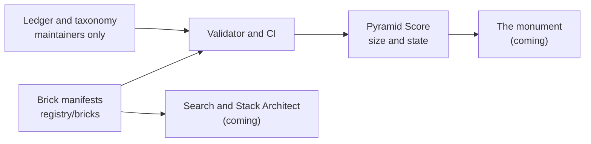

<p align="center">
  
</p>

<h1 align="center">GitPyramid</h1>

<p align="center">
  The pyramid of all the relevant repos and tools a developer needs.<br>
  An open registry of open-source projects, explored as a 3D pyramid. Every project is a brick, and
  anyone can add one in about 10 minutes.
</p>

<p align="center">
  <a href="https://github.com/kush07upadhyay/GitPyramid/actions/workflows/ci.yml"></a>
  <a href="LICENSE"></a>
  <a href="registry/LICENSE"></a>
</p>

## Where this stands

GitPyramid is **at the very beginning**, and this is the honest picture:

- The **registry** works. There are 14 bricks, a validator that explains mistakes in plain
  language, a scaffolder, and CI that guards pull requests.
- The **Pyramid Score** (how a project is sized) is written and tested.
- The **3D monument, the search and the AI Stack Architect do not exist yet.** They come next, in
  the order set out in the [roadmap](docs/ROADMAP.md).

So right now the most useful thing you can do is add a brick or review one.

## Add a brick in 10 minutes

You need a web browser and a GitHub account. No Git knowledge.

1. Pick an open-source project that is not listed yet. Check [`registry/bricks`](registry/bricks).
2. Follow the short guide in [CONTRIBUTING](CONTRIBUTING.md#add-a-brick-in-10-minutes). It gives you a
   template to fill in and explains every field.
3. Open the pull request. CI tells you exactly what to fix, with the file and line.
4. Review other open brick pull requests. This is [the review rule](GOVERNANCE.md#the-review-rule-4-for-1),
   and it is how quality stays high.

Not sure where to begin? Look at the [issues for first contributions](https://github.com/kush07upadhyay/GitPyramid/labels/good%20first%20issue).

## How it works



- A **brick** is one JSON file describing one project with facts a reviewer can check. Scores,
  stars and positions are never written by hand. They are computed from live GitHub data.
- **Sponsors fund the stairs, contributors build the walls.** Companies may sponsor the Grand
  Stairways that lead to the bricks. Sponsorship never changes which bricks exist or how they rank.
  Read [the policy](docs/SPONSORSHIP.md).

## Repository map

| Path | What it holds |
| :--- | :--- |
| [`registry/`](registry) | The data: bricks, ledger, taxonomy and scoring constants |
| [`packages/registry`](packages/registry) | Manifest schema, validator and command line tools |
| [`packages/scoring`](packages/scoring) | The Pyramid Score as pure, tested functions |
| [`specs/`](specs) | One specification per feature |
| [`docs/`](docs) | [Product requirements](docs/PRD.md), [architecture](docs/ARCHITECTURE.md), [scoring](docs/SCORING.md), [decisions](docs/decisions) |

## Work on the code

You need Node.js 22 or newer and Git. pnpm comes through Corepack.

```bash
corepack enable
pnpm install
pnpm check      # lint, typecheck, tests, link check and registry validation
```

More in [CONTRIBUTING](CONTRIBUTING.md#work-on-the-code-locally). AI tools read
[AGENTS.md](AGENTS.md).

## Community

- [Code of Conduct](CODE_OF_CONDUCT.md), [Governance](GOVERNANCE.md), [Security](SECURITY.md) and
  [Support](SUPPORT.md)
- Decisions are written down in [docs/decisions](docs/decisions) and the project's rules are in the
  [constitution](.specify/memory/constitution.md).

## Licenses

- Code and documentation: [MIT](LICENSE).
- Registry data (`registry/`): [CC0 1.0](registry/LICENSE), so anyone can reuse it.
- Sponsor logos are owned by their owners and are not covered by either license. See
  [sponsors/NOTICE.md](sponsors/NOTICE.md).
- Files generated by GitHub Spec Kit keep its MIT license. See
  [THIRD_PARTY_NOTICES.md](THIRD_PARTY_NOTICES.md).

## Notices

GitPyramid is an independent project. It is not affiliated with, endorsed by or sponsored by
GitHub, Inc. GitHub is a trademark of GitHub, Inc. Project names and logos mentioned in the registry
belong to their respective owners.
