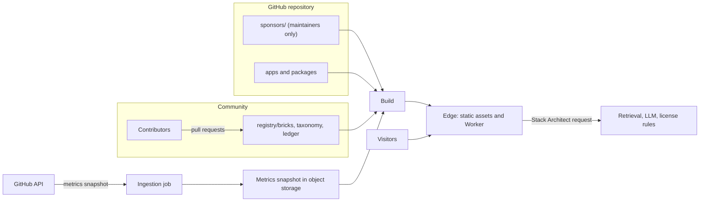
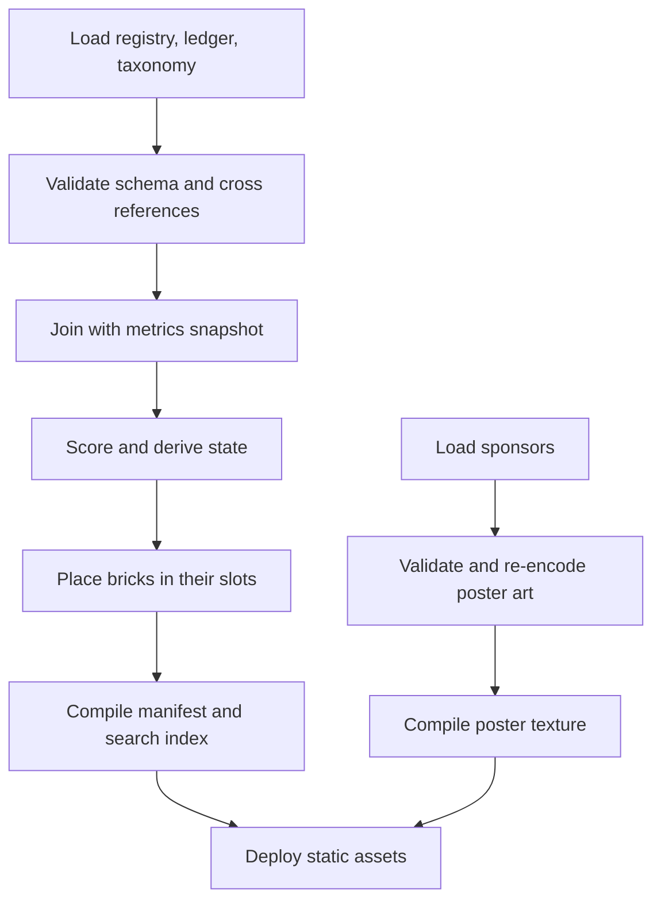
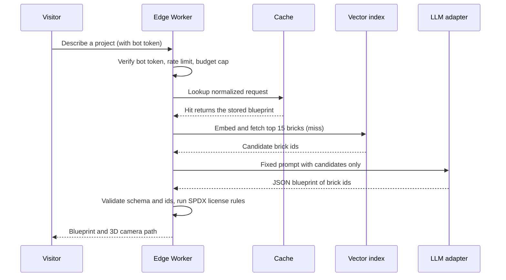

# Architecture

Status: Draft | Rules: [constitution](../.specify/memory/constitution.md) |
Decisions: [docs/decisions](decisions/) | Review of the plan: [PLAN_REVIEW](PLAN_REVIEW.md)

GitPyramid has three jobs: keep a trustworthy registry of open-source projects, turn it into a 3D
monument people can explore, and let an AI assistant suggest compatible stacks from it. The design
keeps the registry as plain files, computes everything else at build time, and keeps the live
infrastructure tiny.

## System context



## Repository layout

```text
registry/
  bricks/<owner>/<repo>.json   community-owned manifests (facts only)
  ledger.jsonl                 maintainer-owned: ids, impact, tier, slot
  taxonomy.json                maintainer-owned: sectors and categories
  scoring.config.json          versioned scoring constants
  schema/brick.schema.json     generated from the Zod schema, never hand-edited
  LICENSE                      CC0 for registry data
sponsors/                      maintainer-only sponsor data and assets
packages/
  registry/                    schema, loader, validator, CLI
  scoring/                     pure scoring functions
  layout/                      (planned) slot lattice and admission
  3d-engine/                   (planned) rendering and picking
  ai-agent/                    (planned) retrieval and synthesis
apps/web/                      (planned) the site
specs/                         Spec Kit specs: spec.md, plan.md, tasks.md
docs/                          product, architecture, decisions, launch kit
```

## Data and trust tiers

Different data has different owners. Mixing them is how registries rot ([F-05](PLAN_REVIEW.md#f-05-derived-values-must-not-live-in-manifests-high)).

| Data | Where | Owner | Changes by |
| :--- | :--- | :--- | :--- |
| Brick facts (name, sector, category, problem, license, links) | `registry/bricks/**` | Community | Pull request with 4-for-1 review |
| Ids, impact level, tier, slot, incubating flag | `registry/ledger.jsonl` | Maintainers or bot | Maintainer commit at admission |
| Sectors and categories | `registry/taxonomy.json` | Maintainers | Reviewed pull request |
| Score constants | `registry/scoring.config.json` | Maintainers | ADR and reviewed pull request |
| Stars, forks, commits, scores, states | Metrics snapshot | Ingestion job | Never committed |
| Sponsors | `sponsors/**` | Maintainers | Maintainer approval only |

Registry data is CC0. Code is MIT. Sponsor logos are neither (see
[SPONSORSHIP](SPONSORSHIP.md#sponsor-data)). See [ADR-0003](decisions/0003-registry-data-model.md).

## Build pipeline



Every step is deterministic: the same inputs give byte-identical outputs (constitution principle
III). A failed ingestion does not stop a build. The build uses the previous snapshot.

## Capacity

Capacity is counted in unit cells, not bricks ([F-02](PLAN_REVIEW.md#f-02-cells-are-not-bricks-high)).
A brick uses 1, 2, 4 or 8 cells. At a mix of 50% small, 30% standard, 15% pillar and 5% foundation the
mean brick uses 2.1 cells.

The plan stacks layers of side 1, 2, 3, ... With a shell 2 cells thick, `L` layers hold
`4L^2 - 12L + 14` cells. Centered, those layers are offset by half a cell, which is not
lattice aligned. A lattice-aligned stack uses odd sides (1, 3, 5, ...) and `K` layers hold
`8K^2 - 16K + 10` cells. The choice is made in the layout spec before any coordinate is published
([F-03](PLAN_REVIEW.md#f-03-layer-numbering-and-lattice-alignment-are-ambiguous-medium)).

| Layers | Unit-step cells | Bricks at 2.1 | Odd-side cells | Bricks at 2.1 |
| ---: | ---: | ---: | ---: | ---: |
| 24 | 2,030 | 966 | 4,234 | 2,016 |
| 26 | 2,406 | 1,145 | 5,002 | 2,381 |
| 30 | 3,254 | 1,549 | 6,730 | 3,204 |
| 37 | 5,046 | 2,402 | 10,370 | 4,938 |
| 60 | 13,694 | 6,520 | 27,850 | 13,261 |

Brick counts are rounded down. Both closed forms were checked against a brute-force sum.

**Epoch I proposal:** about 5,000 cells (unit-step 37 layers, or odd-side 26 layers), roughly 2,400
bricks. The Seed 500 fills about a fifth of it. The empty wireframe slots are the call to action:
a visible monument that is clearly unfinished. When Epoch I is full, Epoch II is a new structure
(a "spire") joined to it, as the plan describes. Layers are numbered from the base.

Carving stairways costs capacity: a stairway that is `w` cells wide and `d` cells deep uses `w * d`
cells per layer. With 5 stairways and `w = 2`, one cell deep costs about 5% to 7% of an Epoch I
shell (240 of 5,002 cells, or 340 of 5,046), and two cells deep costs about 10% to 13%. Depth is a
layout parameter.

## Monument layout

The layout engine turns the ledger into positions. Its rules are invariants, each covered by tests
in the layout spec.

1. **Deterministic.** Same ledger and config, same positions. No unseeded randomness.
2. **Append-only.** A brick's id and slot never change except through a reviewed Epoch migration.
   Ids are never reused.
3. **Visible.** Every brick has at least one exposed face, computed from an occupancy grid
   ([F-15](PLAN_REVIEW.md#f-15-100-of-bricks-are-clickable-is-a-design-goal-not-a-fact-medium)).
4. **Sector coherent.** A sector occupies a contiguous region, so the colors read at a glance.
5. **Typed slots.** The shell is pre-partitioned into slots of 1, 2, 4 and 8 cells in planned
   proportions. Admission takes the next free slot of the brick's size class. There is no packing
   at admission time, so nothing fragments. Empty slots are the wireframes visitors see.
6. **Reserved infrastructure.** Stair cells and sponsor plates are never given to bricks.

Admission, in order: take the ledger entry (sector, category, tier). Use the next free slot of that
size class in the category's band. If the band is full, use the sector's annex. If that is full too,
the brick waits in an overflow queue for the next Epoch. Quotas per category are maintainer data and
change only at an Epoch boundary. Details and the open sector-geometry question (OQ-01) are in
[ADR-0004](decisions/0004-stable-slots-and-ledger.md).

## Compiled manifest

The browser downloads a compact file and builds matrices itself. Sending 4x4 matrices would cost
76 bytes per brick (3.8 MB at 50,000), not the 600 KB budget
([F-14](PLAN_REVIEW.md#f-14-memory-and-wire-size-numbers-are-off-low)).

| Field | Bytes | Meaning |
| :--- | ---: | :--- |
| `x`, `y`, `z` | 6 | Slot origin in cells, signed 16-bit each. |
| `size` | 1 | Size class code. |
| `sector` | 1 | Sector code. |
| `state` | 1 | Solid, translucent, weathered or empty slot. |
| `flags` | 1 | Bit flags such as battle-tested. Never sponsor related. |
| `score` | 1 | Rounded score, 0 to 100. |
| `reserved` | 1 | Keeps records at 12 bytes. |

50,000 records are 600,000 bytes raw, and compress well. Names, descriptions and links are not in
this file. A search index (names and ids) and sharded detail files (about 200 bricks each) load on
demand, so the first paint never waits for text. Sizes are targets to measure, not facts.

## Rendering

Four draw calls, one per pass, hold the budget (constitution principle IV).

| Pass | Content | Technique |
| :--- | :--- | :--- |
| 1 Solid | Stable bricks | Instanced mesh, per-instance color, depth writes on. |
| 2 Translucent | Rising bricks | See [ADR-0009](decisions/0009-picking-and-transparency.md). Stochastic `alphaHash` is grainy without temporal anti-aliasing, so the candidates are per-instance opacity with sorting, or a deterministic dither. |
| 3 Wireframe | Empty slots | Instanced line segments, no blending cost. |
| 4 Posters | Sponsor plates | Instanced quads sampling one texture array, so any number of sponsors is one draw call. |

Other rules: device pixel ratio capped at 1.5, frustum culling, no per-frame allocation, textures
and geometries disposed on unmount. A toggle switches to the **Architect Table View**, a plain
accessible HTML table. It is also the default on devices that fail a quick capability check and for
visitors who prefer reduced motion.

**Picking.** `three-mesh-bvh` does not remove the per-instance loop of an `InstancedMesh`
([F-12](PLAN_REVIEW.md#f-12-three-mesh-bvh-does-not-speed-up-instancedmesh-picking-high)). Because
bricks sit on a lattice, the leading candidate is a voxel ray march over an occupancy grid: cost
depends on ray length, not on brick count, and it needs no library. The alternative is the instance
BVH in `@three.ez/instanced-mesh` behind an interface. A benchmark at 50,000 bricks on a mid-range
phone decides.

## Grand Stairways

A **Grand Stairway** is a channel carved through the shell with one **tread** per layer. A group of
treads is a **landing**: a platform where the camera pauses and shows the bricks of one category.
The vertical face of a tread is a **riser**, and a riser can carry a **Sponsor Step** poster. Stairs
are the navigation spine: sector, then category, then brick. See
[ADR-0008](decisions/0008-grand-stairways-and-sponsor-steps.md) and
[spec 003](../specs/003-grand-stairways-sponsor-steps/spec.md).

- **Navigation.** Selecting a category or a search result flies the camera along the stairway to
  the right landing, then to the brick. Keyboard: up and down move between landings, left and right
  switch stairways, Enter opens a category, Escape leaves stair mode. A tap skips any animation. Deep
  links such as `/brick/<owner>/<repo>` open focused on the brick with no tour.
- **Reduced motion.** Tours become instant jumps with a short cross-fade.
- **Poster pipeline.** `sponsors/*.json` and logo files are validated and re-encoded by the build.
  The sponsor never supplies the final pixels. Every logo is centered on a standard plate (`light` or
  `dark`) so it cannot imitate our interface. Tiles are 512 by 256, WebP, at most 16 KB each, in one
  atlas of at most 512 KB loaded after first render, and uploaded as a texture array.
- **Defaults.** The default build and every fork render neutral placeholders. Only the official
  deployment injects real art.
- **Accessibility.** Posters are never between bricks in keyboard or screen-reader order. Sponsors
  appear once in a labeled "Sponsors" region. Alt text is required.
- **Isolation.** Sponsor data is not an input to scoring, layout, search or the AI. Tests assert
  that the compiled brick manifest is byte-identical with and without sponsors.

## Search and the Stack Architect



- **Tier 1** runs in the browser against the in-memory index: ids, names, categories and visual
  filters. It costs nothing and works offline once loaded.
- **Tier 2** is the Worker above. It fails closed: when the monthly budget cap is reached, bot
  checks fail or the model times out, it turns itself off and Tier 1 keeps working.
- **Trust boundary.** Manifest text is untrusted. The model is told only to choose from the ids it
  was given. Output is validated against a JSON schema and every id must be one of the candidates.
  Anything else is dropped ([F-21](PLAN_REVIEW.md#f-21-manifests-can-attack-the-llm-high)).
- **License advice** comes from a deterministic SPDX rule table, never from the model, and is
  labeled "not legal advice" ([F-22](PLAN_REVIEW.md#f-22-license-checks-must-not-come-from-an-llm-high)).
- **Providers** sit behind one adapter interface with a fallback chain, so a free-tier change does
  not force a rewrite ([F-20](PLAN_REVIEW.md#f-20-free-tier-providers-can-change-medium)).
- **Stack permalinks** use the content hash of the sorted brick ids. There is no free-text title in
  the first version.

## Ingestion

A scheduled job refreshes metrics for every brick and writes one versioned snapshot to object
storage. The built-in Actions token is too small (1,000 GraphQL points an hour per repository), so
the job uses a read-only GitHub App or fine-grained token held as a secret
([F-16](PLAN_REVIEW.md#f-16-actions-github_token-is-too-small-for-ingestion-high)).

- GraphQL batches of 50 to 100 repositories fetch stars, forks, default-branch commit counts, dates
  and issue counts, with a pause between pages and exponential backoff on secondary limits.
- REST with ETags fetches contributor counts. A 304 costs no quota.
- Failures keep the previous value. A repository with no contributor count yet is "unrated".

## Hosting, CI and security

- **Hosting.** Workers with static assets ([ADR-0011](decisions/0011-web-framework-and-hosting.md)).
  Static requests are free. The Free plan caps a Worker version at 20,000 static files, so brick
  pages come from sharded data, not 50,000 prerendered files. The domain's nameservers must be on
  Cloudflare to attach it.
- **CI.** `pull_request` only, `contents: read`, third-party actions pinned to a commit SHA, no
  `pull_request_target`, concurrency cancel. Registry checks on changed files can call the GitHub API
  with the built-in token.
- **Headers.** A strict Content Security Policy: scripts, images and connections from our own origin
  only, and `frame-ancestors 'none'`. This also stops third-party sponsor code by construction.
- **Privacy.** No cookies and no third-party analytics. Sponsor reporting is first-party and
  aggregate (see [SPONSORSHIP](SPONSORSHIP.md#reporting-without-trackers)).

## Failure modes

| Failure | Behavior |
| :--- | :--- |
| No WebGL2, low-end device, reduced motion | Architect Table View. |
| JavaScript disabled | Static HTML index of sectors and categories. |
| Ingestion fails | Build uses the previous snapshot. |
| Poster asset missing or invalid | The step shows plain stone. Brick data is unaffected. |
| AI budget reached, bot check fails, model down | Stack Architect off, Tier 1 search on. |
| GitHub API rate limit in CI | Online check becomes a warning, not a failure. |
| Brick repository deleted, renamed or archived | Weekly job flags it. Maintainers update or retire the brick. |
